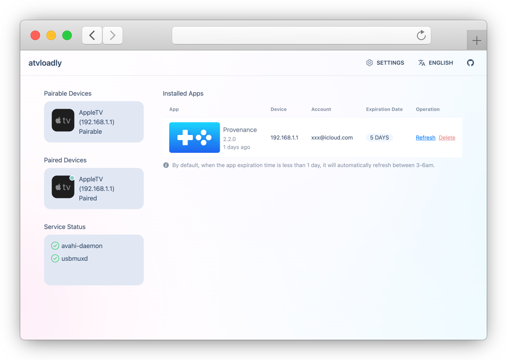

<p align="center">
  <picture>
    <source media="(prefers-color-scheme: dark)" srcset="./doc/preview/logo_dark.svg">
    
  </picture>
</p>

<div align="center">

[](https://github.com/bitxeno/atvloadly/releases)
[](https://hub.docker.com/r/bitxeno/atvloadly)
[](https://hub.docker.com/r/bitxeno/atvloadly)
[](https://hub.docker.com/r/bitxeno/atvloadly)
[](https://github.com/bitxeno/atvloadly/blob/master/LICENSE)

</div>

<div align="center">

[English](./README.md) | [Svenska](./README_sv.md) | [中文](./README_cn.md) | [Српски (ћирилица)](./README_sr.md) | Srpski (latinica)

</div>

atvloadly je veb-servis za instaliranje IPA aplikacija na Apple TV bez App Store-a. Koristi [Impactor](https://github.com/claration/Impactor) kao osnovu za instalaciju i automatsko obnavljanje aplikacija kako bi ostale dostupne. Radi kao Docker servis na Linux/OpenWrt sistemima ili kao izvorna desktop aplikacija na macOS-u i Windows-u.

## Funkcionalnosti

- Pokretanje kroz Docker (Linux/OpenWrt) ili kao desktop aplikacija (macOS / Windows)
- Uparivanje sa Apple TV uređajima
- Automatsko obnavljanje instaliranih aplikacija
- Praćenje GitHub izdanja i AltStore izvora, uz ručno ili automatsko instaliranje ažuriranja
- Korišćenje više Apple ID naloga
- Potpisivanje sopstvenim sertifikatom (P12 + profil za provizionisanje), bez Apple ID naloga
- Korisnički interfejs na više jezika
- Instaliranje aplikacije pod prilagođenim identifikatorom paketa (Apple ID ili P12), pored originalne aplikacije

## Snimci ekrana

<p align="center">
  
</p>
<p align="center">
  
</p>

## Instalacija

### Docker (Linux/OpenWrt)

1. Na Linux/OpenWrt računaru instalirajte `avahi-daemon`.

   **OpenWrt:**
   ```sh
   opkg install avahi-dbus-daemon
   /etc/init.d/avahi-daemon start
   ```

   **Ubuntu:**
   ```sh
   sudo apt-get -y install avahi-daemon
   sudo systemctl restart avahi-daemon
   ```

2. Pokrenite kontejner i prilagodite putanju do direktorijuma za podatke.

   **Docker:**
   ```sh
   docker run --security-opt seccomp:unconfined -d --name=atvloadly --restart=always -p 5533:80 -v /path/to/mount/dir:/data -v /var/run/dbus:/var/run/dbus -v /var/run/avahi-daemon:/var/run/avahi-daemon bitxeno/atvloadly:latest
   ```

   Direktorijume `/var/run/dbus` i `/var/run/avahi-daemon` sa računara treba deliti sa kontejnerom.

   Ako Avahi nije instaliran (na primer pri ručnom dodavanju uređaja po IP adresi ili kroz Tailscale), atvloadly isključuje automatsko otkrivanje umesto stalnih pokušaja povezivanja. Ručno upareni uređaji ostaju dostupni.

   Automatsko otkrivanje možete isključiti pomoću `zeroconf: false` u `config.yaml`, promenljive okruženja `ZEROCONF_ENABLED=false` ili argumenta `--zeroconf=false`. Kada je otkrivanje isključeno, ne pokreću se ni Avahi ni ugrađeni zeroconf preglednik, a modul statusa servisa nije prikazan na početnoj stranici. Redosled prioriteta: `--zeroconf` > `ZEROCONF_ENABLED` > `config.yaml`.

   Ako koristite mrežni režim hosta i želite drugi port, postavite promenljivu okruženja:

   ```sh
   SERVICE_PORT=5533
   ```

   **Docker Compose:**
   ```sh
   wget https://raw.githubusercontent.com/bitxeno/atvloadly/refs/heads/master/docker-compose.yml
   docker compose pull
   docker compose up -d
   ```

### Desktop aplikacija (macOS / Windows)

**macOS 15+ (preporučeno, Homebrew):**

```sh
brew install --cask bitxeno/tap/atvloadly
```

**Windows 10/11 (x64 / arm64):**

Preuzmite i pokrenite instalacionu datoteku (`.exe`) sa stranice [Releases](https://github.com/bitxeno/atvloadly/releases).

## Prvi koraci

### Priprema (važno)

1. **Poseban Apple ID nalog za instalaciju.** Mogu se koristiti besplatni i developerski nalozi. Iz bezbednosnih razloga nemojte koristiti svoj svakodnevni nalog. Besplatni Apple ID ima ograničen broj sertifikata za potpisivanje koje dele svi alati za instaliranje. Ako nema slobodnih sertifikata, atvloadly neće sam opozvati postojeći: na stranici za instalaciju možete izabrati koji sertifikat sme da bude opozvan.
2. **Telefon ili drugi pouzdani uređaj za dvofaktorsku autentifikaciju (2FA).** atvloadly se pri prijavljivanju predstavlja kao virtuelni MacBook. Apple šalje verifikacioni kod na registrovani broj telefona ili već prijavljeni uređaj. Potvrdite prijavljivanje i unesite kod.

### Postupak uparivanja i instalacije

1. Na Apple TV uređaju otvorite `Settings → Remotes and Devices → Remote App and Devices` i uključite režim uparivanja.
2. Otvorite veb-interfejs atvloadly; uređaj spreman za uparivanje trebalo bi da se pojavi.
3. Izaberite Apple TV i završite uparivanje.
4. Vratite se na početnu stranicu i proverite da li se uređaj prikazuje kao povezan.
5. Otvorite stranicu za instalaciju na tom uređaju, odaberite IPA datoteku i kliknite na dugme za instaliranje.

### Potpisivanje spoljnim sertifikatom (P12)

Ako imate sertifikat za potpisivanje aplikacija, možete uvesti `.p12` datoteku (sa lozinkom, koja može biti prazna) i odgovarajući `.mobileprovision` profil. Za Apple TV potreban je **tvOS** profil koji sadrži UDID tog uređaja. Zatim na stranici za instalaciju izaberite **Spoljni sertifikat**. U ovom režimu Apple ID nije potreban i ne koristi se.

Aplikacije potpisane spoljnim sertifikatom ne obnavljaju se automatski. Ističu kada istekne sertifikat ili profil, šta god nastupi ranije. Ponovna instalacija sa istim sertifikatom i profilom ne produžava taj rok. Kada zamenite profil ili identitet za potpisivanje, ponovo instalirajte ili ažurirajte aplikaciju da bi se primenio novi rok. Aplikacije mogu da prate GitHub ili AltStore izvore; ažuriranja se potpisuju istim identitetom.

Privatni ključevi se čuvaju šifrovani pomoću ključa za instalaciju (`signing.key_file`, podrazumevano `/data/keys/signing-identity.key`). Sačuvajte rezervnu kopiju ovog ključa zajedno sa bazom podataka. atvloadly nema ugrađenu autentifikaciju, zato ga koristite samo na pouzdanoj mreži.

[Detaljno uputstvo za spoljne sertifikate (na engleskom)](./doc/external-certificate.md)

## Česta pitanja

**1. Koliko aplikacija mogu da instaliram besplatnim nalogom?**

Jedan besplatni Apple ID može da registruje do 10 aplikacija, dok istovremeno mogu biti aktivne najviše 3. Instaliranje dodatnih aplikacija može učiniti ranije instalirane aplikacije nedostupnim.

**2. Apple TV nije pronađen. Šta da radim?**

- Isključite VPN, ponovo pokrenite Apple TV, uključite režim uparivanja i proverite da li alat za otkrivanje uređaja vidi servis `_remotepairing-manual-pairing._tcp`.
- Po potrebi ponovo pokrenite `avahi-daemon`.
- Ako je neophodno, pokušajte sa `privileged: true` u `docker-compose.yml` ili `--privileged` u `docker run` komandi, umesto `--security-opt seccomp:unconfined`.
- Desktop verzija (macOS / Windows) ne koristi Avahi: proverite da li su računar i Apple TV na istoj mreži i da li zaštitni zid dozvoljava mDNS.

**3. Prijavljivanje na Apple nalog ne uspeva.**

Moguće je da su aktivirane Apple bezbednosne provere ili regionalna ograničenja prijavljivanja. Proverite stanje naloga, a po potrebi pokušajte sa posebnim nalogom za instalaciju.

**4. IPA aplikacija se ruši nakon instalacije.**

Neke aplikacije zahtevaju dodatna prava, kao što je CloudKit, koja mogu zahtevati plaćeni developerski nalog. Promena identifikatora paketa tokom instalacije takođe može izazvati rušenje aplikacija koje to ne podržavaju.

**5. Instaliranje više ne radi nakon nadogradnje sistema.**

Možda je potrebno ponovo upariti uređaj. Nove verzije sistema nisu uvek podržane odmah nakon objavljivanja.

**6. Da li mogu da koristim lozinku namenjenu aplikaciji (app-specific password)?**

Trenutno nije podržana.

## API

- `/healthcheck`: stanje servisa (HTTP 200 kada je sve u redu, HTTP 503 kada je neka aplikacija istekla).
- `/mcp`: MCP interfejs sa Streamable HTTP transportom, za povezivanje alata koji instaliraju ili obnavljaju aplikacije.

## Kako izgraditi projekat

[Uputstvo na wikiju (na engleskom)](https://github.com/bitxeno/atvloadly/wiki/How-to-build)

## Zahvalnice

- [Impactor](https://github.com/claration/Impactor): osnova tehnologije za instaliranje
- [idevice](https://github.com/jkcoxson/idevice): implementacija libimobiledevice u jeziku Rust
- [usbmuxd2](https://github.com/tihmstar/usbmuxd2): implementacija usbmuxd za Linux
- [frida-core](https://github.com/frida/frida-core): referenca za udaljeno uparivanje

## Odricanje od odgovornosti

- Softver je namenjen učenju i razmeni znanja. Autor ne preuzima pravnu odgovornost za bezbednosne rizike ili gubitke nastale njegovom upotrebom.
- Pre upotrebe morate razumeti i prihvatiti moguće rizike, uključujući i blokiranje naloga.
