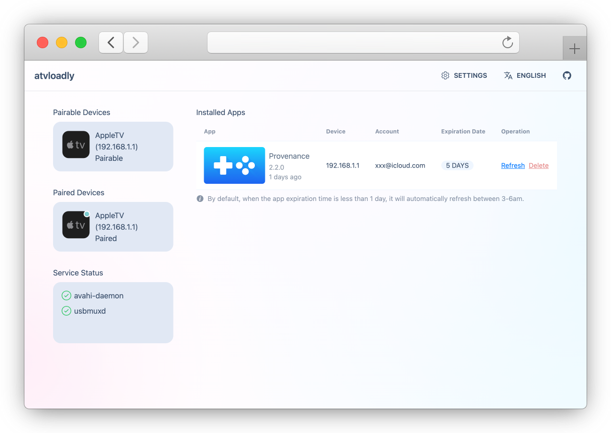
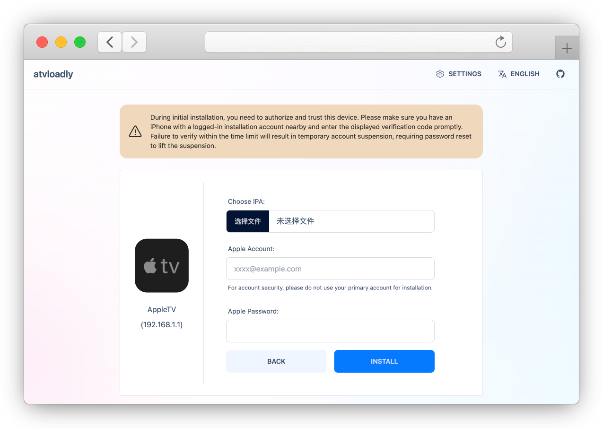

<p align="center">
  <picture>
    <source media="(prefers-color-scheme: dark)" srcset="../preview/logo_dark.svg">
    
  </picture>
</p>


<div align="center">

[](https://github.com/bitxeno/atvloadly/releases)
[](https://hub.docker.com/r/bitxeno/atvloadly)
[](https://hub.docker.com/r/bitxeno/atvloadly)
[](https://hub.docker.com/r/bitxeno/atvloadly)
[](https://github.com/bitxeno/atvloadly/blob/master/LICENSE)

</div>

<div align="center">

[English](../../README.md) | [Svenska](README_sv.md) | [中文](README_cn.md) | [Српски (ћирилица)](README_sr.md) | [Srpski (latinica)](README_sr_Latn.md) | Русский | [Tiếng Việt](README_vi.md)

</div>

atvloadly — веб-сервис для sideload-установки приложений на Apple TV. В его основе лежит технология [Impactor](https://github.com/claration/Impactor), а сервис автоматически продлевает подпись приложений, чтобы они оставались доступны долгое время. Работает как Docker-сервис на Linux/OpenWrt или как нативное настольное приложение на macOS и Windows.

## Возможности

* Запуск в Docker (Linux/OpenWrt) или нативное настольное приложение (macOS / Windows)
* Поддержка сопряжения с Apple TV
* Автоматическое продление подписи приложений
* Отслеживание релизов GitHub и источников AltStore с ручным или автоматическим обновлением приложений
* Поддержка нескольких аккаунтов Apple ID
* Подпись собственным сертификатом (P12 + профиль подготовки) без Apple ID
* Поддержка нескольких языков (i18n)
* Установка приложения под пользовательским идентификатором пакета (Apple ID или P12) рядом с оригиналом

## Скриншоты

<p align="center">
  
</p>
<p align="center">
  
</p>

## Установка

### Docker (Linux/OpenWrt)

1. На хосте Linux/OpenWrt нужно установить `avahi-daemon`.

   **OpenWrt:**
   ```
   opkg install avahi-dbus-daemon
   /etc/init.d/avahi-daemon start
   ```

   **Ubuntu:**
   ```
   sudo apt-get -y install avahi-daemon
   sudo systemctl restart avahi-daemon
   ```

2. Для установки используйте команду ниже; не забудьте изменить монтируемый каталог.

   **Docker:**
   ```
   docker run --security-opt seccomp:unconfined -d --name=atvloadly --restart=always -p 5533:80 -v /path/to/mount/dir:/data -v /var/run/dbus:/var/run/dbus -v /var/run/avahi-daemon:/var/run/avahi-daemon bitxeno/atvloadly:latest
   ```

   Каталоги `/var/run/dbus` и `/var/run/avahi-daemon` хоста нужно пробросить в Docker-контейнер.

   Если хотите использовать сеть хоста (HOST) и изменить порт, добавьте в контейнер переменную окружения:

   ```
   SERVICE_PORT=5533
   ```

   **Docker Compose:**
   ```
   wget https://raw.githubusercontent.com/bitxeno/atvloadly/refs/heads/master/docker-compose.yml
   docker compose pull
   docker compose up -d
   ```

### Настольное приложение (macOS / Windows)

**macOS 15+ (рекомендуется, Homebrew):**

```
brew install --cask bitxeno/tap/atvloadly
```

**Windows 10/11 (x64 / arm64):**

Скачайте и запустите установщик (`.exe`) со страницы [Releases](https://github.com/bitxeno/atvloadly/releases).

## Начало работы

### Подготовка (очень важно‼️)

1. Отдельный («выгоревший») аккаунт
> Выделенный Apple ID для установки: подойдёт и бесплатный, и платный аккаунт разработчика (**Из соображений безопасности не используйте привычный вам аккаунт — создайте отдельный аккаунт для установки!**)
> Бесплатный Apple ID допускает лишь несколько сертификатов подписи, которые делятся между всеми инструментами sideload, использующими этот аккаунт. Если atvloadly не может создать сертификат, потому что лимит исчерпан, он никогда не отзывает сертификаты самостоятельно: на странице установки предлагается выбрать, какой сертификат (если он вообще нужен) можно отозвать.
2. Телефон для двухфакторной аутентификации (2FA)
> atvloadly должен быть авторизован как доверенное устройство (он эмулирует MacBook). При входе Apple отправляет код 2FA на зарегистрированный номер телефона аккаунта или на устройство, где уже выполнен вход в аккаунт установки. Не откладывайте подтверждение и проверку.

### Порядок работы

1. Откройте меню настроек Apple TV, выберите `Пульты и устройства -> Приложение Remote и устройства`, чтобы войти в режим сопряжения.
2. Откройте веб-интерфейс управления — обычно в нём отображается доступное для сопряжения устройство `AppleTV`.
3. Нажмите на устройство `AppleTV`, чтобы открыть страницу сопряжения, и завершите сопряжение.
4. После успешного сопряжения вернитесь на главную страницу — подключённая `AppleTV` будет отображена.
5. Нажмите на подключённую `AppleTV`, чтобы перейти на страницу установки, выберите нужный IPA-файл и нажмите `Установить`.

### Подпись внешним сертификатом (P12)

Если у вас уже есть сертификат подписи кода, вы можете импортировать его `.p12` (с паролем, который может быть пустым) и соответствующий профиль `.mobileprovision` (для Apple TV это должен быть профиль **tvOS**, в котором указан UDID устройства), затем выбрать **Внешний сертификат** на странице установки. Apple ID при этом не запрашивается и не используется.

Приложения, подписанные внешним сертификатом, автоматически не продлеваются: они перестают работать по истечении срока действия сертификата или профиля подготовки — что наступит раньше. Переустановка с тем же сертификатом и профилем не продлевает эту дату. После замены профиля (или с новым удостоверением подписи) переустановите или обновите приложение, чтобы применить новый срок действия. Их можно устанавливать из источников (релизы GitHub или AltStore) и отслеживать их; обновления подписываются тем же удостоверением.

Закрытые ключи хранятся в зашифрованном виде с помощью файла ключа развёртывания (`signing.key_file`, по умолчанию `/data/keys/signing-identity.key`): сделайте его резервную копию вместе с базой данных. Аутентификация в atvloadly отсутствует, поэтому держите его в доверенной сети.

[>> Руководство по внешнему сертификату](../external-certificate.md)

## FAQ

1. Сколько приложений можно установить с бесплатным аккаунтом?

> Каждый бесплатный Apple ID может зарегистрировать до 10 приложений и активировать одновременно до 3. Установка более 3 приводит к тому, что ранее установленные приложения становятся недоступны.

2. Apple TV не найдено

> 1. Выключите VPN, перезапустите Apple TV, снова войдите в режим сопряжения, убедитесь, что в **[Инструментах]** обнаруживаются устройства типа `_remotepairing-manual-pairing._tcp`, и выполните сопряжение заново.
>
> 2. Попробуйте перезапустить службу `avahi-daemon`.
>
> 3. Попробуйте использовать `privileged: true` в docker-compose.yml или `--privileged` в команде docker run вместо `--security-opt seccomp:unconfined`.
>
> 4. В настольном приложении (macOS / Windows) avahi-daemon не используется: проверьте, что Apple TV находится в той же сети, а локальный брандмауэр разрешает приложению использовать mDNS.

3. Не удаётся войти в Apple-аккаунт

> Возможно, сработала система риск-контроля Apple. У Apple есть ограничения на вход в некоторых регионах. В качестве альтернативы попробуйте создать новый аккаунт.

4. IPA вылетает после установки

> Если IPA требует права доступа вроде CloudKit, подписать и включить их могут только платные аккаунты разработчика. После sideload-установки с помощью atvloadly `Bundle Identifier` IPA изменяется, и некоторые IPA ограничивают это, что приводит к вылетам.

5. Установка не работает после обновления системы.

> После обновления системы требуется повторное сопряжение. Обычно новые выпущенные системы сразу не поддерживаются. Рекомендуется отключить автоматическое обновление системы.

6. Можно ли использовать пароли приложений (App-specific passwords)? Это безопаснее?

> Сейчас это не поддерживается.

## API

- `/healthcheck`: возвращает состояние работоспособности службы (200 — нормально, 503 — срок действия одного из приложений истёк).

- `/mcp`: API сервиса MCP, потоковый HTTP-транспорт (streamable http); можно подключить AI-агента для установки или продления приложений.

## Как собрать

[>> wiki](https://github.com/bitxeno/atvloadly/wiki/How-to-build)

## Благодарности

[Impactor](https://github.com/claration/Impactor): ядро sideload

[idevice](https://github.com/jkcoxson/idevice): libimobiledevice на чистом Rust

[usbmuxd2](https://github.com/tihmstar/usbmuxd2): реализация usbmuxd для Linux

[frida-core:](https://github.com/frida/frida-core): справочная реализация подключения для удалённого сопряжения

## Отказ от ответственности

* Это программное обеспечение предназначено только для обучения и общения. Автор не несёт юридической ответственности за риски безопасности или убытки, возникшие в результате использования этого ПО.
* Прежде чем использовать это программное обеспечение, вы должны осознать и принять соответствующие риски, включая, помимо прочего, блокировку аккаунта, которые не связаны с этим ПО.
