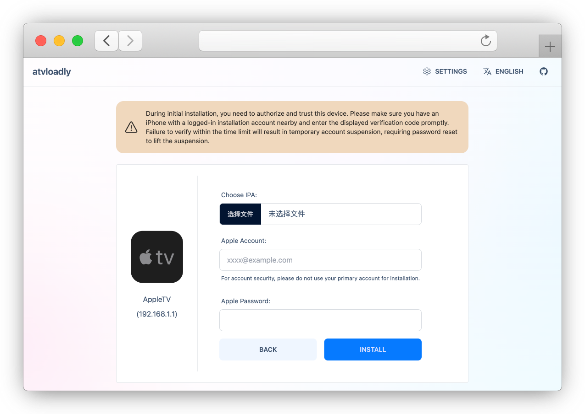

<p align="center">
  <picture>
    <source media="(prefers-color-scheme: dark)" srcset="../preview/logo_dark.svg">
    
  </picture>
</p>

<div align="center">

[](https://github.com/bitxeno/atvloadly/releases)
[](https://hub.docker.com/r/bitxeno/atvloadly)
[](https://hub.docker.com/r/bitxeno/atvloadly)
[](https://hub.docker.com/r/bitxeno/atvloadly)
[](https://github.com/bitxeno/atvloadly/blob/master/LICENSE)

</div>

<div align="center">

[English](../../README.md) | [Svenska](README_sv.md) | [中文](README_cn.md) | Српски (ћирилица) | [Srpski (latinica)](README_sr_Latn.md)

</div>

atvloadly је веб-сервис за инсталирање IPA апликација на Apple TV без App Store-а. Користи [Impactor](https://github.com/claration/Impactor) као основу за инсталацију и аутоматско обнављање апликација како би остале доступне. Ради као Docker сервис на Linux/OpenWrt системима или као изворна десктоп апликација на macOS-у и Windows-у.

## Функционалности

- Покретање кроз Docker (Linux/OpenWrt) или као десктоп апликација (macOS / Windows)
- Упаривање са Apple TV уређајима
- Аутоматско обнављање инсталираних апликација
- Праћење GitHub издања и AltStore извора, уз ручно или аутоматско инсталирање ажурирања
- Коришћење више Apple ID налога
- Потписивање сопственим сертификатом (P12 + профил за провизионисање), без Apple ID налога
- Кориснички интерфејс на више језика
- Инсталирање апликације под прилагођеним идентификатором пакета (Apple ID или P12), поред оригиналне апликације

## Снимци екрана

<p align="center">
  
</p>
<p align="center">
  
</p>

## Инсталација

### Docker (Linux/OpenWrt)

1. На Linux/OpenWrt рачунару инсталирајте `avahi-daemon`.

   **OpenWrt:**
   ```sh
   opkg install avahi-dbus-daemon
   /etc/init.d/avahi-daemon start
   ```

   **Ubuntu:**
   ```sh
   sudo apt-get -y install avahi-daemon
   sudo systemctl restart avahi-daemon
   ```

2. Покрените контејнер и прилагодите путању до директоријума за податке.

   **Docker:**
   ```sh
   docker run --security-opt seccomp:unconfined -d --name=atvloadly --restart=always -p 5533:80 -v /path/to/mount/dir:/data -v /var/run/dbus:/var/run/dbus -v /var/run/avahi-daemon:/var/run/avahi-daemon bitxeno/atvloadly:latest
   ```

   Директоријуме `/var/run/dbus` и `/var/run/avahi-daemon` са рачунара треба делити са контејнером.

   Ако Avahi није инсталиран (на пример при ручном додавању уређаја по ИП адреси или кроз Tailscale), atvloadly искључује аутоматско откривање уместо сталних покушаја повезивања. Ручно упарени уређаји остају доступни.

   Аутоматско откривање можете искључити помоћу `zeroconf: false` у `config.yaml`, променљиве окружења `ZEROCONF_ENABLED=false` или аргумента `--zeroconf=false`. Када је откривање искључено, не покрећу се ни Avahi ни уграђени зероцонф прегледник, а модул статуса сервиса није приказан на почетној страници. Редослед приоритета: `--zeroconf` > `ZEROCONF_ENABLED` > `config.yaml`.

   Ако користите мрежни режим хоста и желите други порт, поставите променљиву окружења:

   ```sh
   SERVICE_PORT=5533
   ```

   **Docker Compose:**
   ```sh
   wget https://raw.githubusercontent.com/bitxeno/atvloadly/refs/heads/master/docker-compose.yml
   docker compose pull
   docker compose up -d
   ```

### Десктоп апликација (macOS / Windows)

**macOS 15+ (препоручено, Homebrew):**

```sh
brew install --cask bitxeno/tap/atvloadly
```

**Windows 10/11 (x64 / арм64):**

Преузмите и покрените инсталациону датотеку (`.exe`) са странице [Releases](https://github.com/bitxeno/atvloadly/releases).

## Први кораци

### Припрема (важно)

1. **Посебан Apple ID налог за инсталацију.** Могу се користити бесплатни и девелоперски налози. Из безбедносних разлога немојте користити свој свакодневни налог. Бесплатни Apple ID има ограничен број сертификата за потписивање које деле сви алати за инсталирање. Ако нема слободних сертификата, atvloadly неће сам опозвати постојећи: на страници за инсталацију можете изабрати који сертификат сме да буде опозван.
2. **Телефон или други поуздани уређај за двофакторску аутентификацију (2ФА).** atvloadly се при пријављивању представља као виртуелни MacBook. Apple шаље верификациони код на регистровани број телефона или већ пријављени уређај. Потврдите пријављивање и унесите код.

### Поступак упаривања и инсталације

1. На Apple TV уређају отворите `Settings → Remotes and Devices → Remote App and Devices` и укључите режим упаривања.
2. Отворите веб-интерфејс atvloadly; уређај спреман за упаривање требало би да се појави.
3. Изаберите Apple TV и завршите упаривање.
4. Вратите се на почетну страницу и проверите да ли се уређај приказује као повезан.
5. Отворите страницу за инсталацију на том уређају, одаберите IPA датотеку и кликните на дугме за инсталирање.

### Потписивање спољним сертификатом (P12)

Ако имате сертификат за потписивање апликација, можете увести `.p12` датотеку (са лозинком, која може бити празна) и одговарајући `.mobileprovision` профил. За Apple TV потребан је **tvOS** профил који садржи UDID тог уређаја. Затим на страници за инсталацију изаберите **Спољни сертификат**. У овом режиму Apple ID није потребан и не користи се.

Апликације потписане спољним сертификатом не обнављају се аутоматски. Истичу када истекне сертификат или профил, шта год наступи раније. Поновна инсталација са истим сертификатом и профилом не продужава тај рок. Када замените профил или идентитет за потписивање, поново инсталирајте или ажурирајте апликацију да би се применио нови рок. Апликације могу да прате GitHub или AltStore изворе; ажурирања се потписују истим идентитетом.

Приватни кључеви се чувају шифровани помоћу кључа за инсталацију (`signing.key_file`, подразумевано `/data/keys/signing-identity.key`). Сачувајте резервну копију овог кључа заједно са базом података. atvloadly нема уграђену аутентификацију, зато га користите само на поузданој мрежи.

[Детаљно упутство за спољне сертификате (на енглеском)](../external-certificate.md)

## Честа питања

**1. Колико апликација могу да инсталирам бесплатним налогом?**

Један бесплатни Apple ID може да региструје до 10 апликација, док истовремено могу бити активне највише 3. Инсталирање додатних апликација може учинити раније инсталиране апликације недоступним.

**2. Apple TV није пронађен. Шта да радим?**

- Искључите VPN, поново покрените Apple TV, укључите режим упаривања и проверите да ли алат за откривање уређаја види сервис `_remotepairing-manual-pairing._tcp`.
- По потреби поново покрените `avahi-daemon`.
- Ако је неопходно, покушајте са `privileged: true` у `docker-compose.yml` или `--privileged` у `docker run` команди, уместо `--security-opt seccomp:unconfined`.
- Десктоп верзија (macOS / Windows) не користи Avahi: проверите да ли су рачунар и Apple TV на истој мрежи и да ли заштитни зид дозвољава mDNS.

**3. Пријављивање на Apple налог не успева.**

Могуће је да су активиране Apple безбедносне провере или регионална ограничења пријављивања. Проверите стање налога, а по потреби покушајте са посебним налогом за инсталацију.

**4. IPA апликација се руши након инсталације.**

Неке апликације захтевају додатна права, као што је CloudKit, која могу захтевати плаћени девелоперски налог. Промена идентификатора пакета током инсталације такође може изазвати рушење апликација које то не подржавају.

**5. Инсталирање више не ради након надоградње система.**

Можда је потребно поново упарити уређај. Нове верзије система нису увек подржане одмах након објављивања.

**6. Да ли могу да користим лозинку намењену апликацији (app-specific password)?**

Тренутно није подржана.

## АПИ

- `/healthcheck`: стање сервиса (HTTP 200 када је све у реду, HTTP 503 када је нека апликација истекла).
- `/mcp`: MCP интерфејс са Стреамабле HTTP транспортом, за повезивање алата који инсталирају или обнављају апликације.

## Како изградити пројекат

[Упутство на викију (на енглеском)](https://github.com/bitxeno/atvloadly/wiki/How-to-build)

## Захвалнице

- [Impactor](https://github.com/claration/Impactor): основа технологије за инсталирање
- [idevice](https://github.com/jkcoxson/idevice): имплементација libimobiledevice у језику Rust
- [usbmuxd2](https://github.com/tihmstar/usbmuxd2): имплементација usbmuxd за Linux
- [frida-core](https://github.com/frida/frida-core): референца за удаљено упаривање

## Одрицање од одговорности

- Софтвер је намењен учењу и размени знања. Аутор не преузима правну одговорност за безбедносне ризике или губитке настале његовом употребом.
- Пре употребе морате разумети и прихватити могуће ризике, укључујући и блокирање налога.
