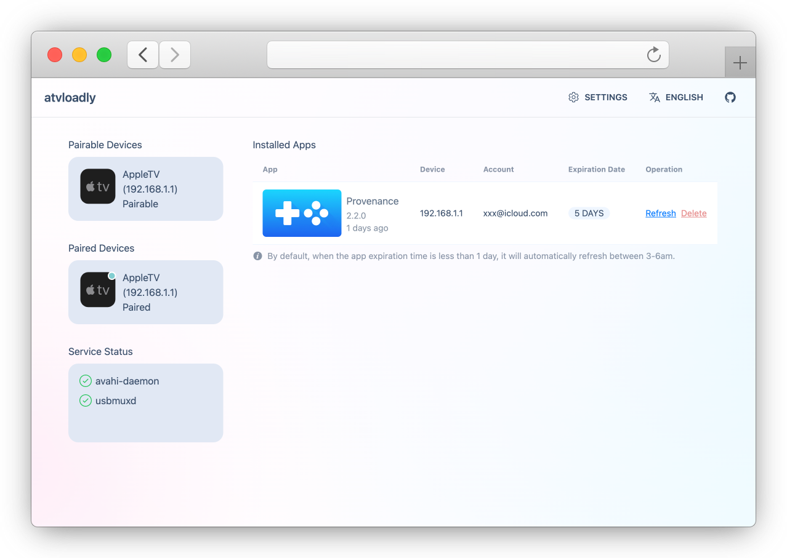
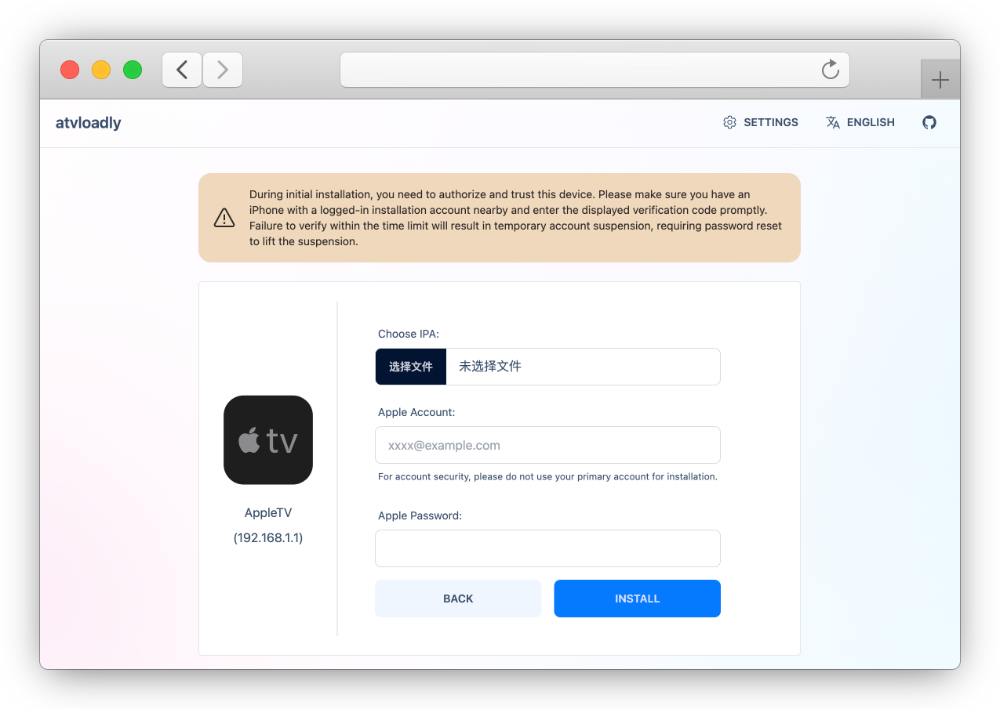

<p align="center">
  <picture>
    <source media="(prefers-color-scheme: dark)" srcset="../preview/logo_dark.svg">
    
  </picture>
</p>


<div align="center">

[](https://github.com/bitxeno/atvloadly/releases)
[](https://hub.docker.com/r/bitxeno/atvloadly)
[](https://hub.docker.com/r/bitxeno/atvloadly)
[](https://hub.docker.com/r/bitxeno/atvloadly)
[](https://github.com/bitxeno/atvloadly/blob/master/LICENSE)

</div>

<div align="center">

[English](../../README.md) | [Svenska](README_sv.md) | [中文](README_cn.md) | [Српски (ћирилица)](README_sr.md) | [Srpski (latinica)](README_sr_Latn.md) | [Русский](README_ru.md) | Tiếng Việt

</div>

atvloadly là một dịch vụ web hỗ trợ sideload ứng dụng lên Apple TV. Dịch vụ dùng [Impactor](https://github.com/claration/Impactor) làm công nghệ nền để sideload và tự động làm mới ứng dụng để ứng dụng luôn dùng được lâu dài. atvloadly có thể chạy dưới dạng dịch vụ Docker trên Linux/OpenWrt, hoặc dưới dạng ứng dụng desktop gốc trên macOS và Windows.

## Tính năng

* Chạy bằng Docker (Linux/OpenWrt) hoặc ứng dụng desktop gốc (macOS / Windows)
* Hỗ trợ ghép đôi (pair) với AppleTV
* Hỗ trợ tự động làm mới ứng dụng
* Hỗ trợ theo dõi bản phát hành trên GitHub / nguồn AltStore, cập nhật ứng dụng thủ công hoặc tự động
* Hỗ trợ dùng nhiều tài khoản Apple ID
* Hỗ trợ ký bằng chứng chỉ của riêng bạn (P12 + provisioning profile), không cần Apple ID
* Hỗ trợ đa ngôn ngữ (i18n)
* Hỗ trợ cài ứng dụng dưới một bundle identifier tùy chỉnh (Apple ID hoặc P12), song song với ứng dụng gốc

## Ảnh chụp màn hình

<p align="center">
  
</p>
<p align="center">
  
</p>

## Cài đặt

### Docker (Linux/OpenWrt)

1. Máy chủ Linux/OpenWrt cần cài `avahi-daemon`.
   
   **OpenWrt：**
   ```
   opkg install avahi-dbus-daemon
   /etc/init.d/avahi-daemon start
   ```
   
   **Ubuntu:**
   ```
   sudo apt-get -y install avahi-daemon
   sudo systemctl restart avahi-daemon
   ```

2. Tham khảo lệnh dưới đây để cài đặt, nhớ sửa lại thư mục mount.
   
   **Docker:**
   ```
   docker run --security-opt seccomp:unconfined -d --name=atvloadly --restart=always -p 5533:80 -v /path/to/mount/dir:/data -v /var/run/dbus:/var/run/dbus -v /var/run/avahi-daemon:/var/run/avahi-daemon bitxeno/atvloadly:latest
   ```

   Thư mục `/var/run/dbus` và `/var/run/avahi-daemon` của máy chủ cần được chia sẻ cho container Docker sử dụng.

   Nếu bạn muốn dùng mạng HOST và muốn đổi cổng lắng nghe, có thể thêm biến môi trường cho container:

   ```
   SERVICE_PORT=5533
   ```

   **Docker Compose:**
   ```
   wget https://raw.githubusercontent.com/bitxeno/atvloadly/refs/heads/master/docker-compose.yml
   docker compose pull
   docker compose up -d
   ```

### Ứng dụng desktop (macOS / Windows)

**macOS 15+ (khuyên dùng, cài qua Homebrew):**

```
brew install --cask bitxeno/tap/atvloadly
```

**Windows 10/11 (x64 / arm64):**

Tải về và chạy trình cài đặt (`.exe`) từ trang [Releases](https://github.com/bitxeno/atvloadly/releases).


## Bắt đầu sử dụng

### Chuẩn bị (rất quan trọng‼️)

1. Một tài khoản phụ
> Một tài khoản Apple ID riêng chỉ dùng để cài đặt, tài khoản miễn phí hay tài khoản nhà phát triển đều được (**Vì lý do bảo mật, đừng dùng tài khoản bạn thường dùng. Hãy tạo một tài khoản phụ riêng để cài đặt!**)
> Apple ID miễn phí chỉ được tạo một số ít chứng chỉ ký, và số chứng chỉ này dùng chung cho mọi công cụ sideload đăng nhập bằng tài khoản đó. Khi atvloadly không tạo được chứng chỉ mới vì tài khoản đã hết chỗ, nó không bao giờ tự thu hồi chứng chỉ nào: trang cài đặt sẽ hỏi bạn chứng chỉ nào (nếu có) được phép thu hồi.
2. Một điện thoại để xác minh 2FA
> atvloadly cần được cấp quyền làm thiết bị tin cậy (nó sẽ được giả lập thành một chiếc MacBook). Khi đăng nhập, Apple sẽ gửi mã xác minh 2FA đến số điện thoại đã đăng ký của tài khoản, hoặc đến thiết bị đã đăng nhập bằng tài khoản cài đặt. Hãy cho phép và nhập mã xác minh kịp thời.

### Các bước thực hiện

1. Mở menu cài đặt của Apple TV, chọn `Remote and Devices -> Remote App and Devices` để vào chế độ ghép đôi.
2. Mở trang quản lý web, bình thường trang sẽ hiển thị `AppleTV` có thể ghép đôi.
3. Nhấn vào thiết bị `AppleTV` để vào trang ghép đôi và hoàn tất việc ghép đôi.
4. Sau khi ghép đôi thành công, quay lại trang chủ, `AppleTV` đã kết nối sẽ hiển thị ở đó.
5. Nhấn vào `AppleTV` đã kết nối để vào trang cài đặt sideload, chọn file IPA cần sideload rồi nhấn `Install`.

### Ký bằng chứng chỉ ngoài (P12)

Nếu bạn đã có sẵn chứng chỉ ký mã (code signing certificate), bạn có thể nhập file `.p12` của chứng chỉ (kèm mật khẩu, có thể để trống) và một profile `.mobileprovision` tương ứng (với Apple TV thì là profile **tvOS** có chứa UDID của Apple TV), rồi chọn **External certificate** trên trang cài đặt. Chế độ này không hỏi và không dùng Apple ID. Ứng dụng ký theo cách này không được tự động làm mới: ứng dụng hết hạn theo ngày hết hạn sớm hơn giữa chứng chỉ và profile, và cài lại với cùng chứng chỉ và profile cũng không kéo dài được ngày đó. Sau khi thay profile (hoặc dùng một identity mới), hãy cài lại hoặc cập nhật ứng dụng để áp dụng ngày hết hạn mới. Các ứng dụng này có thể được cài từ một nguồn (GitHub releases hoặc AltStore) và theo dõi nguồn đó, các bản cập nhật sẽ được ký bằng cùng identity.

Khóa riêng tư (private key) được lưu ở dạng mã hóa bằng một file khóa triển khai (`signing.key_file`, mặc định là `/data/keys/signing-identity.key`): hãy sao lưu file này cùng với cơ sở dữ liệu. atvloadly không có cơ chế xác thực, nên chỉ chạy nó trong mạng tin cậy.

[>> Hướng dẫn dùng chứng chỉ ngoài (tiếng Anh)](../external-certificate.md)

## Câu hỏi thường gặp

1. Tài khoản miễn phí cài được bao nhiêu ứng dụng?

> Mỗi Apple ID miễn phí có thể đăng ký tối đa 10 ứng dụng và kích hoạt cùng lúc tối đa 3 ứng dụng. Cài quá 3 ứng dụng sẽ khiến các ứng dụng đã cài trước đó không dùng được nữa.

2. Không tìm thấy AppleTV

> 1. Hãy tắt VPN, khởi động lại AppleTV, vào lại chế độ ghép đôi, đảm bảo **[Tool]** phát hiện được thiết bị loại `_remotepairing-manual-pairing._tcp`, rồi ghép đôi lại.
>
> 2. Thử khởi động lại dịch vụ `avahi-daemon`.
>
> 3. Thử dùng `privileged: true` trong file docker-compose.yml, hoặc `--privileged` trong lệnh docker run, thay cho `--security-opt seccomp:unconfined`.
>
> 4. Ứng dụng desktop (macOS / Windows) không dùng avahi-daemon: hãy kiểm tra Apple TV có cùng mạng với máy không, và tường lửa trên máy có cho phép ứng dụng dùng mDNS không.

3. Không đăng nhập được tài khoản Apple

> Có thể bạn đã kích hoạt cơ chế kiểm soát rủi ro của Apple. Apple giới hạn đăng nhập ở một số khu vực. Bạn cũng có thể thử tạo một tài khoản mới.

4. IPA bị crash sau khi cài

> Nếu IPA cần các quyền như CloudKit thì chỉ tài khoản nhà phát triển trả phí mới ký và bật được. Sau khi sideload bằng atvloadly, `Bundle Identifier` của IPA sẽ bị thay đổi, và một số IPA chặn việc này nên bị crash.

5. Cài đặt thất bại sau khi nâng cấp hệ điều hành.

> Sau khi nâng cấp hệ điều hành cần ghép đôi lại. Thông thường các phiên bản hệ điều hành mới phát hành sẽ chưa được hỗ trợ. Nên tắt tự động cập nhật hệ điều hành.

6. Có thể dùng mật khẩu dành riêng cho ứng dụng (App-specific password) làm mật khẩu không? Như vậy có an toàn hơn không?

> Hiện chưa hỗ trợ.

## API

- `/healthcheck`: Trả về tình trạng của dịch vụ (200 là bình thường, 503 là có ứng dụng đã hết hạn).

- `/mcp`: API dịch vụ MCP, dùng transport streamable HTTP, có thể kết nối với AI Agent để cài đặt hoặc làm mới ứng dụng.


## Cách build

[>> wiki](https://github.com/bitxeno/atvloadly/wiki/How-to-build)

## Lời cảm ơn

[Impactor](https://github.com/claration/Impactor): lõi sideload

[idevice](https://github.com/jkcoxson/idevice): libimobiledevice viết hoàn toàn bằng Rust

[usbmuxd2](https://github.com/tihmstar/usbmuxd2): bản triển khai usbmuxd cho Linux

[frida-core](https://github.com/frida/frida-core): tài liệu tham khảo cho kết nối ghép đôi từ xa

## Miễn trừ trách nhiệm

* Phần mềm này chỉ dùng cho mục đích học tập và trao đổi. Tác giả không chịu bất kỳ trách nhiệm pháp lý nào đối với rủi ro bảo mật hay thiệt hại phát sinh từ việc sử dụng phần mềm này.
* Trước khi dùng phần mềm này, bạn cần hiểu rõ và tự chịu các rủi ro liên quan, bao gồm nhưng không giới hạn ở việc tài khoản bị khóa; những rủi ro này không liên quan đến phần mềm.
